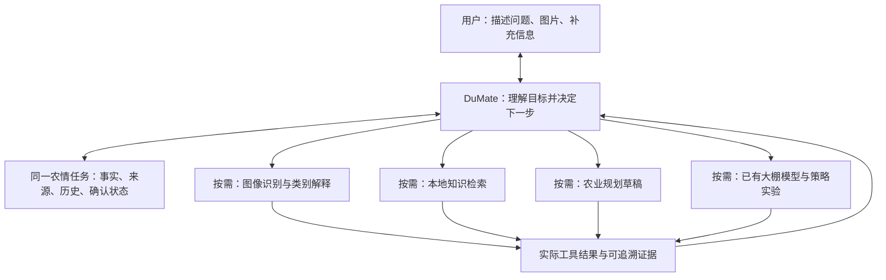

# 禾序 Agent：作品定位与详细方案 v2

日期：2026-10-15。本文是产品与技术设计方案，不代表新增能力已经实现。代码审计基于现有功能分支；本轮不改原算法、服务实现或运行进程。

## 1. 推荐定位

**禾序 Agent 是面向番茄温室的农情研判与农业规划辅助智能体。它围绕同一农情任务理解用户处境，按需追问、识别图片、检索本地知识、生成管理计划，并在用户需要时调用已有大棚模型开展虚拟研究。**

推荐下一版名称：**禾序 Agent——基于 DuMate 的农情研判与农业规划辅助系统**。当前已交付版本仍叫“农业策略实验与智能决策辅助系统”；名称调整应与实际实现及报名信息同步，不能先把未接通能力写成完成。

核心价值是把分散在识别页面、知识库、规划页面和仿真页面里的能力，组织成一段能持续补充信息、引用证据和复查结果的农业任务。P0–P6是可选实验能力，不作为每个问题的默认入口。

### 用户与场景

首要用户是需要整理具体棚况、查询依据和形成待复核管理方案的农技服务人员。种植者可以直接描述问题并补充资料；农业科研教学人员可以继续进行模型对照。首版把完整链路收敛到番茄温室，其他作物仅开放已有权重或知识明确支持的单项能力。

| 用户处境 | 需要解决的问题 | 应交付的结果 |
| --- | --- | --- |
| 有症状照片，不清楚原因 | 候选线索是什么、还缺什么信息 | 识别候选、可信来源、待核实事项及下一步观察建议 |
| 知道基本棚况，想安排近期工作 | 管理事项怎样排序、哪些有条件限制 | 结合所提供情况的计划草稿、依据、复查条件 |
| 有明确研究目标 | 哪些既有策略满足节水、风险等约束 | 实际仿真矩阵、逐项筛选、合格候选或无解说明 |
| 上次已有计划，今天情况变化 | 哪些旧判断需要调整 | 新旧事实差异、更新后的计划及调整依据 |

用户价值验收应聚焦“能否减少重复提供背景、能否说明为什么追问和调用、能否根据新信息更新结论”。目前没有真实省时比例、诊断准确率或产量收益证据，不能用这些作为已验证宣传。

### 定位方案比较

| 方向 | 优点 | 局限 | 决策 |
| --- | --- | --- | --- |
| 继续以固定策略实验为核心 | 现有链路成熟、结果可复算 | 无法充分承接查资料、看图片和实际管理问题 | 保留为实验子能力 |
| 在DuMate中重做整个平台 | 可形成统一新界面 | 工作量大、重复现有功能，容易破坏原系统 | 不采用 |
| 以农情任务为核心，按需调度现有能力 | 发挥已有模型、知识和规划能力，适配多轮对话 | 需补齐窄接口、事实来源和动态路由验证 | 推荐 |

## 2. 对 DuMate、原平台和模型的分工

- **DuMate**：理解用户目的、提出必要问题、组织任务、选择可用工具、依据返回结果解释和交付。
- **农情任务档案**：保存事实、来源、用户确认、图片证据、多轮记录和关联实验，避免换一个工具就丢失背景。
- **原农业平台**：提供YOLO识别、知识检索、类别映射、农业规划服务、大棚状态及已有仿真。
- **适配层**：限定工具权限、校验参数、控制预算和并发、转换流式结果、保存可关联证据。
- **使用者和负责人**：核对农情及结果，确认真实生产中的执行安排。

大棚模型直接使用本项目已有模型，不开发替代模型。DuMate的对话推理、原平台的规划文本生成、YOLO图像分类、大棚响应仿真是不同能力：不能把语言模型写的计划当作物理模型验证，也不能把P3内部择优称为LLM决策。

## 3. 现有基础与真实缺口

| 能力 | 仓库中已有基础 | 本轮确认的边界 | 下一步工作 |
| --- | --- | --- | --- |
| 农情解析 | `AgriPlanController`的`situation/parse` | 已由现适配层真实调用；输出是待确认草稿 | 与会话事实合并，避免重复解析已确认信息 |
| 图像识别 | `PredictionController`、Flask `predictImg`、9份既有权重 | 代码和权重存在；5000本次检查未监听；新Skill未跑通识别 | 启动/核验现服务，封装受控图片输入与固定权重映射 |
| 本地检索 | `KnowledgeSearchTool`、`KnowledgeRetriever`、`CitationFormatter` | 可返回引文、低分、降级；当前适配层只查status，没有检索 | 新增窄只读桥，复用工具，不重建知识库或检索算法 |
| 类别解释 | `VisionExplainTool`和已核验类别映射 | 支持作物消歧、无映射终止；尚未接入DuMate | 只使用实际模型标签，返回映射依据和缺口 |
| 本地论文与资料 | `KnowledgeLibraryController`及来源登记 | 原系统已有目录和来源能力；不等于每轮阅读全文 | 优先返回相关证据和来源；全文按需、按权限读取 |
| 农业规划 | `POST /ai/agri/plan/deduce` | SSE；接收结构化农情；未关联任务时会计算参考基线 | 优先关联同一农情任务，转换流并加长任务状态管理 |
| 多轮农情档案 | `FarmTaskController`、`FarmTaskService` | 已有提问、证据、观测、对话和运行关联 | 适配层仅开放必要子集，补充事实来源与冲突处理 |
| 大棚状态与响应 | M3、场景服务及任务运行关联 | 历史观测回放与设备响应仿真分开；参数未实棚校准 | 按用户目的调用；仅传实际支持的参数 |
| 策略实验与筛选 | 现适配层analyze/evaluate/report及本机decide | 现有版本真实跑通；P0–P6仍为固定番茄参考场景 | 保留为实验分支，目标变化新建实验并关联原农情任务 |

**重要发现：** `PlanDeductionService`在关联`taskId`或`simulationRunId`时，会读取`FarmTaskService.context`，并明确不计算固定旧场景基线。这是复用真实情境规划的关键入口。

**必须区分：** 有用户上下文的规划文本，不等于所有用户数值已经进入物理仿真；关联任务也不自动意味着用户照片、温湿度和面积成为模型初始条件。每次仿真都必须列出实际接受的参数、忽略的参数和来源。

现有40项测试及真实实验记录属于已交付0.3版，不覆盖本文拟新增的视觉、检索、规划桥接和动态会话。不能据此宣布v2整体已验收。

## 4. 对话主线：围绕问题动态选择下一步

每轮处理的是“当前目标 + 已确认事实 + 新证据 + 未解决问题”，不预设必须调用所有工具。

| 当前请求 | 可以先做什么 | 何时追问 | 通常不需要 |
| --- | --- | --- | --- |
| 解释一个农业概念 | 查询相关知识并说明适用范围 | 问题涉及具体条件且现有信息不足时 | 图片、仿真、完整农情表 |
| 叶片异常、用户有照片 | 确认作物和图片来源，识别候选并检索对应证据 | 部位、发生时间、范围等会改变判断时 | 固定56天实验 |
| 下周怎样管理 | 读取既有档案，补充生育期和影响安排的近期情况 | 当前资料不足以形成具体计划时 | 每次重新上传全部背景 |
| 比较节水策略 | 确认基准、风险指标、允许增幅及模拟窗口 | “明显改善”“风险不能增加”等条件含糊时 | 病害确诊、设备实控 |
| 新照片或新观测改变判断 | 标记新证据、检查与旧事实的冲突，更新相关结论 | 单位、时间或来源不明确时 | 无条件重跑所有工具 |

采用渐进追问：每轮通常只问最影响当前结论的少数问题，说明为什么需要。已有明确回答不重复问；用户不知道时保留“未知”，提供获取信息的方法或降低结论具体程度。能给出有依据的通用说明时，可以先回答，再提出可选补充信息。

不要求每个人都填写同一套完整表单。职责、经验和已有设备只在影响解释方式或方案可执行性时询问；不收集与任务无关的个人资料。

## 5. 农情档案与多轮记忆

首版只做当前农情任务的可查看记忆，不宣称跨项目永久记忆。沿用`FarmTaskService`，补充适配层的来源及字段校验；不另建一套相互不一致的农情数据库。

### 事实记录

| 字段 | 意义 |
| --- | --- |
| 字段名、值、单位 | 如作物、生育期、棚温；单位不得靠猜测补全 |
| 来源类别 | 用户陈述、人工观测记录、图像模型候选、知识引文、外部天气、模型仿真、派生值 |
| 原文或证据编号 | 能找回用户哪句话、哪张图、哪个知识片段、哪次工具输出 |
| 观测时间与记录时间 | 昨天测量不等于当前状态；保存两个时间 |
| 确认状态 | 已确认、待确认、冲突、未知；模型抽取不自动升级为用户确认 |
| 版本与适用范围 | 标明属于哪座棚、哪轮任务、哪个部位或时间窗口 |
| 识别置信度或检索分数 | 分别保存并注明意义，不能混成统一“可靠度”百分比 |

用户陈述只能证明“用户这样提供了信息”，不能自动标记为传感器实测。知识引文是一般知识；图片标签是模型候选；仿真数据必须单独呈现。知识库来源时间也不等于当前农情观测时间。

### 更新与冲突

- 用户修正“面积不是600平方米，是300平方米”：保留旧记录，新增修正事件，后续使用新确认值；相关旧计划标记需要复核。
- 用户今天提供新温湿度：按观测时间更新，不覆盖旧时序；只重做受影响的检索或计划。
- 用户说早疫病、图片模型给其他类别：同时保留，不以任何一方直接确诊；询问确诊依据并解释证据限制。
- 用户没有传感器：不强制填写精确测量值，保留缺项，输出适用范围更窄的观察/管理草稿。
- 新问题改为另一个地块或作物：新建农情任务，避免混用上一个任务的图片和模型状态。

### 编号与重复调用

需要区分三层编号：农情任务ID长期关联背景；每轮对话有独立turnId；每次工具调用有独立requestId/稳定调用键。重试同一调用沿用原键，新输入或新轮次生成新调用键。

现有0.3客户端以一个实验UUID绑定一次analyze/evaluate/report，适合不可变实验，但不能直接当作多轮会话：否则第二次识别或用户补充后重新解析会错误复用第一次结果。v2应增加会话层，保留原实验执行器作为子任务。用户改变实验阈值时，新建实验ID并继续关联同一农情任务；不得覆盖旧矩阵。

## 6. 按需能力设计

### 6.1 图像识别与类别解释

用户提供图片且当前问题确需视觉线索时调用。优先确认作物，按固定白名单选择既有模型；不允许从对话中传入任意权重路径。只接收用户授权的图片文件，限制体积、类型和像素，校验实际内容；禁止让识别服务按用户文本中的任意URL下载资源。

输出包括模型标识、权重摘要、图片摘要、实际返回的候选类别与置信度、是否无检出、处理时间。标注图按任务权限提供。置信度保持源服务返回的意义，不做展示性放大，也不称为确诊概率。

随后按需调用原`VisionExplainTool`，以真实标签和作物查已核验映射。没有映射、跨作物歧义、低分或无检出时明确说明，不能用相似病名填空。未检出不等于健康。只传照片时不强制运行仿真；无照片时也可以先检索用户描述并追问，不把缺图当作所有农业问题的阻断条件。

### 6.2 本地知识与用户资料

本地库分成三类：已索引农业知识、登记的论文/标准及人工摘要、用户当前任务上传的农情资料。三类来源分开展示。

检索复用`KnowledgeSearchTool`与已有BM25/向量/RRF，不重新开发算法或批量重灌数据。适配结果至少包括实际检索词、作物范围、来源名称/版本、证据片段、引用编号、相关性与降级标记。图像类别对应关系由`VisionExplainTool`负责，不能只靠词面相近认定。

只有status成功时，应写“知识库可用”；真正返回了相关片段后才能写“本次已检索并引用”。低分、无命中或向量降级要如实输出。知识未覆盖时，可以回答用户已提供的事实和必要的一般说明，但不能伪造引用或给出确定诊断。

用户资料按需询问：例如症状发生时间、最近管理记录、相关照片或农情CSV。先解释用途，由用户选择提供哪些资料。复用现有CSV解析时，必须展示映射列、忽略列和数据范围；不能宣称任意Excel、PDF或时间序列都能直接进入模型。上传资料默认只服务当前任务，入全局知识库属于另一项明确操作。

### 6.3 农业管理计划

根据问题需要确认目标、生育期、生产方式、近期关键操作和限制条件。不是所有计划都需要完整22项农情；能改变当前安排的缺项优先询问。

复用`PlanDeductionService`，优先传入同一`taskId`；需要当前虚拟棚状态时才关联`simulationRunId`。沿用用户已确认事实及实际知识证据。若接口上下文尚未包含本次检索引文，桥接层应显式传入可引用的证据摘要，或由DuMate根据证据组织计划；不能假定原规划服务已经执行了RAG。

推荐输出结构：

| 内容 | 要求 |
| --- | --- |
| 本轮理解 | 当前问题、目标、已知条件和关键未知项 |
| 优先事项 | 先处理什么、依据是什么；紧急程度不能由单个图片分数推断 |
| 计划事项 | 时间窗口、事项、前提、负责人或执行角色、复查条件 |
| 适配用户限制 | 用户实际拥有的设施、人工安排、预算或可用观测手段 |
| 证据与假设 | 每条关键判断的证据及缺项；哪些内容只是条件性建议 |
| 后续反馈 | 用户需要观察或补充什么，何种变化触发重新研判 |

具体施用量、设备操作和经营安排需要与实际条件和负责人核查。图像候选与一般资料不能自动转成确定用药处方。计划默认草稿，生成草稿不等于执行设备或农事动作。

原规划接口是SSE，默认服务预算240秒，不能照搬现适配层75秒/客户端90秒后宣称长规划稳定。建议将其包装为`plan.start`返回任务ID、`plan.status`返回进度/结果的有界长任务，保留取消与结果不确定状态，不做失败后换键自动重发。

### 6.4 大棚模型与实验

大棚模型沿用本项目现有实现。区分三类使用：

1. **读取已关联虚拟棚状态**：说明状态来源及回放时间，用于解释当前虚拟情境。
2. **预览支持的场景响应**：仅使用参数目录真正支持并完成映射的输入；在独立虚拟运行中预览，不影响真实设备。
3. **P0–P6参考对照**：继续使用现有确定性评测，确认用户理解固定参考场景后才运行；P0–P3参与管理策略筛选，P4–P6单列消融。

不能把三类输出混在同一“个性化效果”中。模型未接受用户面积、症状或棚温时，报告直接列明没有使用；不支持的作物或情境不能靠提示词变成支持。用户问实际棚况时，可以结合事实和知识形成计划草稿，但不得给出未经模型支持的个性化产量/利润预测。

实验目标含糊时澄清基准、指标、允许增幅及窗口。继续复用0.3版确定性筛选：有合格且优于基准的方案给研究候选，无合格或无改善则不推荐新方案；不静默放宽条件。已有七组负利润、M3历史回放、设备响应仿真、P3非LLM、无实棚验证等边界全部保留。

## 7. 对话示例与演示脚本

以下是设计示例，不是新增能力已完成的执行日志。图片标签、引用和仿真值必须使用正式录制时的实际返回。

**第一轮：用户提出具体问题**

用户：“我棚里的番茄下部叶片有黄斑，想知道怎么办，也想安排下周管理。”

智能体先概括任务；优先了解当前生育期、发生时间及是否能提供相关照片。已有农情档案中的信息直接引用，不重复询问。可以先检索描述，说明当前只能给初步线索。

**第二轮：用户补充条件与照片**

用户：“现在坐果期，发现几天了，最近比较潮湿。这是照片。我没有自动控湿设备。”

智能体保存新事实及时间范围，运行匹配作物的既有识别模型，按实际候选查类别映射和本地证据。若用户没有精确湿度，不补造88%等数字；计划应考虑缺少自动设备，不能直接推荐用户无法执行的自动调控步骤。

**第三轮：交付待复核计划**

围绕实际已知条件输出近期任务草稿、依据和复查点。没有充分依据时说明缺口，不把图片候选升级为确诊。用户只想要管理计划时，到此即可，不跑P0–P6。

**第四轮：用户主动提出实验**

用户：“还想研究不同策略的节水取舍。”

智能体解释目前可用的参考模型范围，确认基准、风险指标及允许增幅，再创建关联实验。用同一任务背景说明实验局限，不能把固定参考矩阵解释成该棚处方。

**第五轮：新情况触发更新**

用户提供新的照片、观测或执行反馈。智能体更新事实，指出哪些旧假设失效，只重新调用受影响工具；保留旧计划和实验，形成可追踪的更新说明。

## 8. Skill与接口组织

面向使用者保留一个主Skill入口，由DuMate根据本轮问题选择能力；不要要求用户记住一串工具名。可以沿用`agri-research`的安装标识以保留兼容性，更新展示名和能力说明。以下是v2拟新增或扩展的能力契约，不是当前已开放的接口。

| 能力 | 输入边界 | 输出边界 | 接入方式 |
| --- | --- | --- | --- |
| 农情任务维护 | 当前用户的任务ID、问题、明确提供的事实/证据 | 档案版本、已知/缺项/冲突、引用编号 | 包装`FarmTaskService`必要子集 |
| 图像识别 | 受控图片、作物、允许的置信度参数 | 固定模型的候选及摘要、无检出/失败状态 | 受控封装现有YOLO，不开放任意URL/权重 |
| 知识检索与类别解释 | 有长度上限的query/crop/topN；实际模型标签 | 相关片段、真实引用、映射与降级/缺口 | 窄只读桥直连`KnowledgeSearchTool`/`VisionExplainTool` |
| 农业规划任务 | 已确认情境、当前目标、证据引用、可选虚拟运行ID | 进度、计划草稿、缺项、实际来源和局限 | 复用`PlanDeductionService`，封装SSE为有界长任务 |
| 大棚状态/响应预览 | 适配层绑定的虚拟运行及经过校验的模型参数 | 模拟状态、实际使用参数、假设与版本 | 复用M3；首版只读或独立预览，无真实设备控制 |
| 策略评测与筛选 | 原evaluation契约及已确认目标 | 实际矩阵、合格/淘汰原因 | 复用现有evaluate及本机decide |
| 农情任务总结 | 农情任务ID及已有证据，可选计划/实验ID | 当前任务报告，允许没有实验矩阵 | 新增case报告模板；不强制调用evaluate |

### 原平台复用原则

新增窄桥可以放在Spring Boot中的独立适配包，只调用原Service/Tool，不改数学模型与知识检索实现。独立Node对外适配层继续承担鉴权及严格白名单；内部桥仅供适配服务访问，单独验证内部凭证。原接口对既有Vue界面保持兼容。

`AgentChatController`是由模型选工具的通用编排入口，不能靠提示词“只检索”就把它当作强制白名单。`allowSimulationActions=false`也不等于所有其他工具都不可调用。新Skill的知识请求优先走直接只读桥，避免再套一层不受目标工具限制的Agent。

原`/flask/predict`接受权重名和图片URL，还涉及记录与文件上传；不应将它原样开放。对外仅提供受控识别能力，不暴露文件目录、通用下载、用户管理、摄像头、设备控制或任意工具执行。

原`agri.report`要求analysisId和evaluationId，适合实验报告。v2日常规划没有评测时，应生成独立农情任务总结，不能为了满足旧报告入参而偷偷跑一次参考仿真。

### 参数、预算与状态

沿用现有鉴权、请求上限、幂等存档和错误映射。不同工具单独设定预算；图像输入上限单独审计，不整体放宽所有接口的32KiB限制。图片并发初始限制为1，再按实测调整。

长规划采用QUEUED/RUNNING/SUCCEEDED/FAILED/CANCEL_REQUESTED/RESULT_INDETERMINATE等明确状态；排队数量与任务保留期有上限。取消请求、上游实际停止和仍可能继续执行必须区分。已成功的步骤可复用；失败或不确定POST不能通过更换调用键自动重发。

确认事实或研究条件与反复索取调用许可不同：已授权范围内的只读查询和分析正常执行，只在缺失信息、冲突、场景假设或用户改变目标时澄清。真实生产操作始终不在这轮Skill适配范围。

## 9. 必须保留的来源边界

1. 用户陈述、图片模型候选、知识依据、室外天气和虚拟棚状态分别呈现。
2. 症状和模型标签不构成确诊；类目无映射时不得用相似疾病替代。
3. 检索结果只支撑实际相关的说法，不能用有来源数量代替有本轮证据。
4. M3为历史观测回放；温室设备响应是模型仿真；P3前瞻择优不调用LLM。
5. 固定参考实验未使用用户农情时必须明示；关联任务不自动完成参数注入。
6. 没有实棚校准、疗效、产量或盈利验证，不能承诺生产效果。
7. 单个指标领先不能替代整体权衡；参考实验利润为负时照实保留。
8. 文件哈希支持变更核对，不能称为第三方签名或独立认证。

## 10. 分阶段实施顺序

### 阶段A：先处理参赛交付入口

这是提交是否完整的前置工作，与功能开发并行优先进行。核对报名系统接受的DuMate作品链接形式、作品广场入口，以及是否要求评委能重新执行。取得真实入口并从其他浏览器会话验证，不把本机路径、GitHub源码或静态报告当作平台运行入口。

如果需要远程执行，部署受控HTTPS适配服务，保持原后端、私有文件和凭证不公开；提供限额、独立的评审访问方式。任务分享链接用于查看过程和文件，不自动等于可远程重跑。自建网页仅作补充，不能自行认定替代平台要求。通知日期为2026-10-15，具体关门时刻未核实；不能以继续开发为由推迟入口确认。

### 阶段B：贯通“多轮农情 + 真实检索 + 计划”

1. 包装农情任务创建、读取、补充资料和证据接口；建立会话/轮次/调用层次。
2. 增加知识只读桥，返回相关片段、引用和降级信息。
3. 更新Skill路由与追问规则，用同一任务中的用户事实和实际证据形成计划草稿。
4. 接入原规划服务的关联任务模式及长任务状态，明确引用和模型边界。
5. 新增无需evaluationId的农情任务报告。

这一阶段优先于添加更多策略或美化新界面。它解决用户“不能固定流程、要结合具体情况”的核心诉求。

### 阶段C：接通图像与知识解释

1. 检查原推理环境和服务，使用仓库测试图片运行真实识别。
2. 封装图片上传与固定作物权重选择，保存实际输出及图片/模型摘要。
3. 复用类别映射工具，验证作物歧义、无映射、无检出和低置信度路径。
4. 将结果作为候选证据写回同一农情任务，验证它不会自动覆盖用户确认事实。

若推理服务未通过测试，发布版本中标明不可用并继续提供资料/文字分支；不能伪造图片识别成功或用语言模型描述冒充YOLO输出。

### 阶段D：按需接入虚拟棚与现有实验

1. 绑定任务与虚拟运行，记录实际参数与回放时刻。
2. 核对支持的参数映射，读取或在独立虚拟运行中预览。
3. 将既有P0–P6与decide作为可选实验；修改条件产生新实验，保留旧证据。
4. 验证普通资料查询和计划请求不会触发不必要的仿真。

### 阶段E：统一材料与验收

按真正已完成的分支更新名称、简介、方案PDF、Skill和演示脚本；保留当前0.3已验证包，不用v2设计文档冒充新功能交付。记录真实运行、平台分享与可访问性，更新原功能分支的PR，不直接合并main。

## 11. 预计修改文件与模块

以下为实施清单，当前没有创建这些业务模块。

- `skill/agri-research/SKILL.md`：主入口，新增按目的路由、追问与使用边界。
- `skill/agri-research/references/conversation.md`：用户处境、事实更新与提问规则。
- `skill/agri-research/scripts/conversation.mjs`：会话/轮次/工具调用记录和上下文校验；DuMate负责语义理解，不用关键词规则冒充LLM规划。
- `src/case-capabilities.mjs`：只接受受控农情任务及证据操作，复用原FarmTask服务。
- `src/research-capabilities.mjs`：图像、知识和计划窄能力，独立参数契约及结果裁剪。
- `src/sse.mjs`及长任务存档：处理SSE事件、HTTP200中的业务失败、取消和超时。
- `src/server.mjs`、`upstream.mjs`、`config.mjs`、OpenAPI：新增精确路由，继续禁止通用代理。
- 原Spring Boot新增独立适配包中的研究只读控制器：调用已有KnowledgeSearchTool/VisionExplainTool，不重写原算法与原Controller。
- 图像推理必要适配脚本：优先复用原服务；若现服务的共享临时文件妨碍并发隔离，再增加独立薄封装，不训练新模型。
- `test/conversation.test.mjs`、`test/research.test.mjs`、`test/sse.test.mjs`及桥接测试：覆盖下节场景。
- `docs/submission/`：仅在相应能力真实通过后同步更新参赛材料。

## 12. 验收矩阵

| 场景 | 必须观察到的行为 |
| --- | --- |
| 普通知识问题 | 有真实相关检索和引用，不要求上传照片，不跑仿真 |
| 图片问题但缺作物 | 消歧或询问作物，不随意选择权重 |
| 有图片、有完整背景 | 使用已知信息，调用识别与必要检索，不重复问全套问题 |
| 无检出/低置信度/未映射 | 明确限制或补充材料，不输出确定病名 |
| 用户不知道湿度 | 保留未知，不补造传感器值，仍能给适用范围明确的说明 |
| 用户更正事实 | 新值生效、旧值可追踪，相关计划标记需更新 |
| 多轮重复问题与新图片 | 相同已成功调用可复用，新图片/新输入不能返回旧调用结果 |
| 农业规划 | 使用同一任务事实，展示缺项和实际依据，不自动混入旧参考收益 |
| 策略实验 | 明确参考场景和目标，返回实际矩阵、筛选或无解 |
| 新约束或不同地块 | 新实验或新任务边界清楚，不串用图片、证据和运行ID |
| 服务缺失、SSE错误或超时 | 明确失败/不确定，保留证据；不伪造成功、不换键重发 |
| 权限与输入攻击 | 任意文件路径、URL、权重、原用户/设备接口及通用工具代理均被拒绝 |
| 平台交付 | 真实作品链接可访问，执行全过程材料与实际版本一致 |

验收记录要区分：单元/契约测试、真实工具调用、DuMate内执行、他人访问，以及真实生产验证。前四项分别有证据后才能填写完成；本项目当前没有最后一项。

## 13. 推荐比赛演示

主线采用“同一农情任务的三轮变化”：首次描述与关键追问 → 补充照片和实际限制后检索/规划 → 新事实或约束出现后调整。用用户没有某种设备、缺少某项观测等具体限制展示方案为何变化。

可加一个短实验分支，展示“只约束病害积分时有候选，增加最终严重度约束后无解”。它证明目标与证据约束的作用，但不替代实际情境主线。录屏应看到DuMate的选择原因、实际调用和报告，不用固定台词覆盖真实输出。

建议讲述顺序：

1. 用户当前遇到了什么问题，以及信息散落在哪里。
2. DuMate如何判断缺什么，只问必要问题。
3. 原平台提供了哪些真实专业计算或资料依据。
4. 新信息为何导致计划或研究候选变化。
5. 最终交付了什么，哪些仍需人工核查和实棚验证。

不预设视频硬性时长；按报名系统实际上传限制安排。

## 14. 完成标准与本轮交付状态

完成v2的标准是：不同问题走不同分支；同一任务不丢背景；新信息能改变判断；图像、知识、规划和模型结果有实际来源；缺失或失败能如实处理；平台交付入口可访问。

**本轮已完成：** 现有代码能力审计、定位取舍、动态对话与事实设计、接口边界、分阶段实施清单和验收方案。

**本轮未实施：** 新的识别/检索/规划适配、会话代码、服务部署、平台发布或真实录屏。原0.3交付包继续保持其已验证范围。该方案可用于下一轮实施，不能直接把整篇内容作为“已完成功能”提交。

## 15. 代码与规则依据

仓库：`3534435883a-eng/YOLO_AI_CropDisease_Detection_DeepSeek-2`；审计时功能分支基线提交为`939e0e762326fc0c573096d44b974e2dbcdb8c7a`。

- `controller/PredictionController.java`与Flask的`main.py`、`predict/predictImg.py`：实际图像入口、权重输入、记录与文件上传依赖。
- `agent/tool/KnowledgeSearchTool.java`、`agent/rag/KnowledgeRetriever.java`、`CitationFormatter.java`：已有检索及引用能力。
- `agent/tool/VisionExplainTool.java`：作物消歧、已核验映射、无可用依据的终态。
- `agent/controller/KnowledgeLibraryController.java`：本地资料与来源登记。
- `agent/task/FarmTaskController.java`、`FarmTaskService.java`：同一农情任务、证据、补充记录和运行上下文。
- `agent/controller/AgriPlanController.java`、`agent/dto/AgriPlanRequest.java`、`agent/plan/PlanDeductionService.java`：结构化农情、SSE长规划、任务关联与基线分支。
- `agent/orchestrator/AgentOrchestrator.java`：通用Agent选工具及allowSimulationActions边界，不能视为窄检索API。
- `integrations/dumate/`：现有三接口、客户端、确定性筛选及已执行测试/证据。
- [比赛介绍及提交流程](https://www.saihuan.net/article/keji/299.html)：平台作品链接、执行全过程、简介及方案材料。
- [百度官方Skill管理](https://cloud.baidu.com/doc/Dumate/s/5mmydgic3)：技能包安装与启用；它本身不证明作品已发布。
- [百度官方任务分享说明](https://cloud.baidu.com/doc/Dumate/s/5mqtdo3nt)：分享对话及文件访问；不能由此推断农业服务已云端部署。
